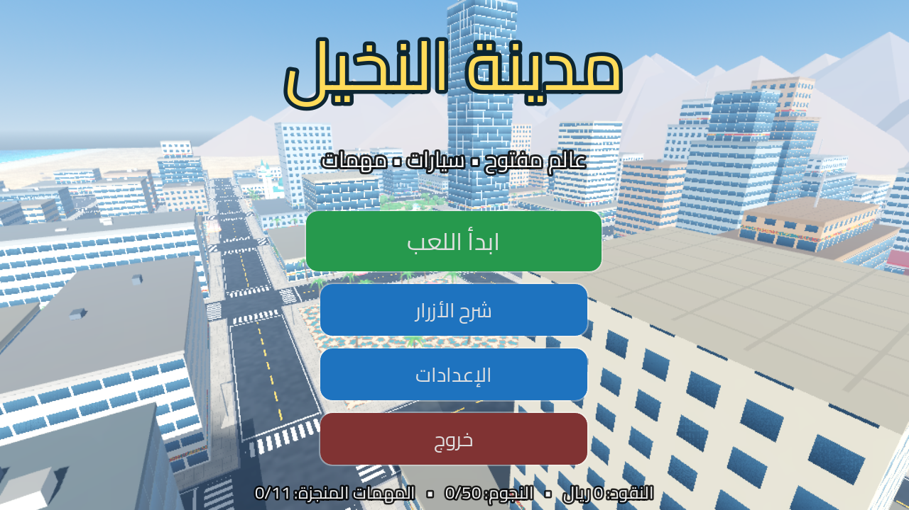
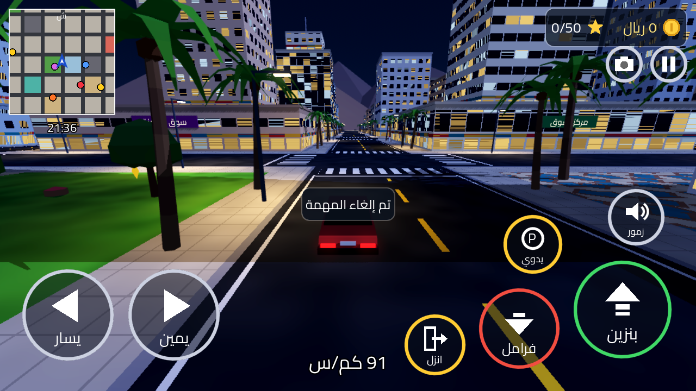
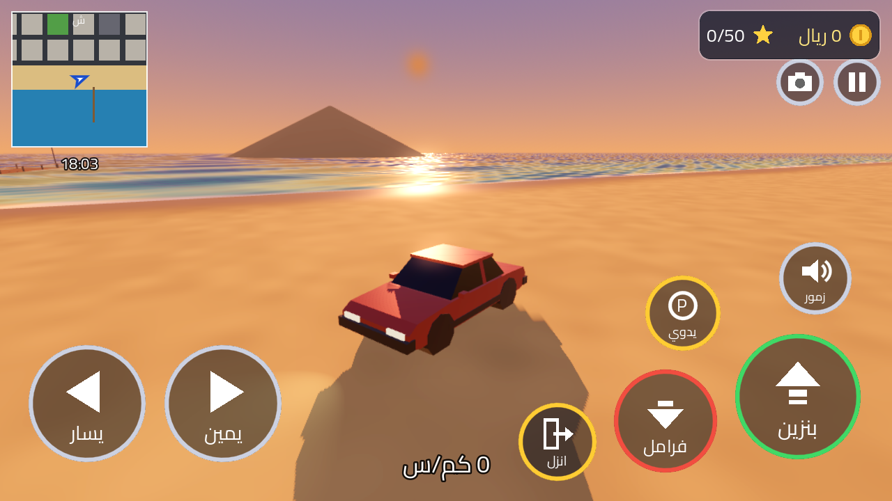
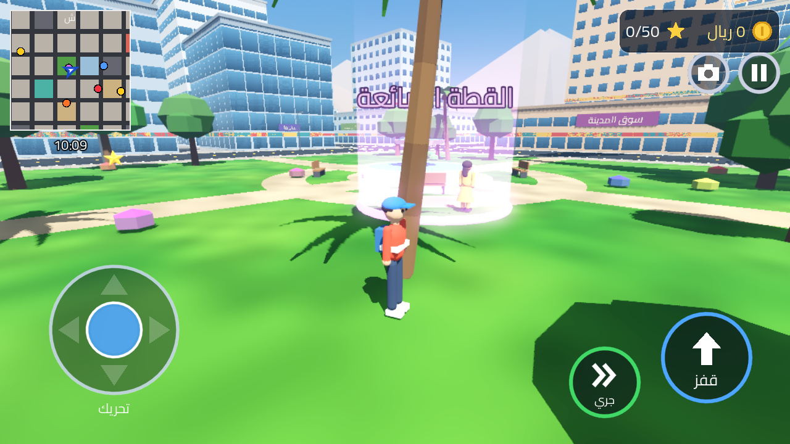
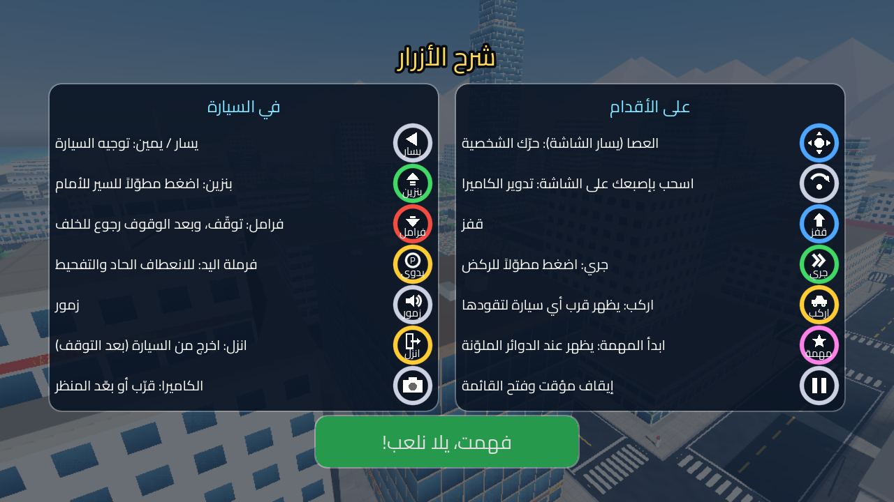

# مدينة النخيل 🌴

لعبة عالم مفتوح ثلاثية الأبعاد للأندرويد مبنية على **Godot 4.5** — كل شيء فيها مصنوع بالكود:
المجسمات، الشخصيات، الأنيميشن، السيارات، الأصوات والموسيقى. لا يوجد أي ملف رسومات أو صوت خارجي
(ما عدا الخط العربي «Cairo» برخصة OFL).

## ماذا يوجد في اللعبة؟

- **مدينة كاملة**: 81 بلوك، ناطحات سحاب، محلات بلافتات عربية، برج النخيل، مسجد، حدائق، مواقف، معرض سيارات.
- **شاطئ وبحر** مع رصيف بحري ومنارة، و**صحراء** فيها واحة وخيام وجِمال وجبال.
- **6 سيارات**: سيدان، تاكسي، بيك أب، جيب، رياضية، خارقة — لكل واحدة سرعة وتماسك مختلف.
- **مرور ومشاة**: سيارات تمشي في الشوارع وتقف عند العوائق، ومشاة يسلّمون عليك ويبتعدون عن السيارات.
- **دورة ليل ونهار**: شروق، غروب، ليل مع إضاءة النوافذ وأعمدة الإنارة وكشافات السيارة.
- **11 مهمة جانبية** + 50 نجمة مخفية:
  - 🚕 مشوار تاكسي — خذ الراكب ووصّله قبل انتهاء الوقت
  - 📦 توصيل طلبات — 3 طلبات متتالية
  - 🏁 سباقات — وسط المدينة، الكورنيش، ورالي الصحراء (مع حفظ أفضل وقت)
  - 🅿️ تحدي الاصطفاف — اصطف بدقة داخل المربع
  - 🐱 القطة الضائعة — ابحث عنها بالسمع وأرجعها لصاحبتها
- **نقود ومعرض سيارات**: اجمع النقود من المهمات واشترِ سيارات أسرع.
- **8 سكنات للسيارة**: خطوط سباق، كلاسيك، صحراوي، أسود مطفي، النخيل، نيون مضيء، ذهبي — تُشترى بالنقود من «سكنات السيارة» في القائمة مع معاينة ثلاثية الأبعاد.
- **حفظ تلقائي** للتقدم.

## الأزرار

| على الأقدام | في السيارة |
|---|---|
| العصا (يسار الشاشة): تحريك | يسار / يمين: التوجيه |
| سحب على الشاشة: تدوير الكاميرا | بنزين: للأمام |
| قفز | فرامل: توقف ثم رجوع للخلف |
| جري (ضغط مطوّل) | يدوي: فرملة اليد للتفحيط |
| اركب: يظهر قرب السيارة | زمور |
| ابدأ المهمة: يظهر عند الدوائر الملوّنة | انزل: الخروج من السيارة |

كل الأزرار مكتوب عليها اسمها بالعربي، وفي القائمة شاشة «شرح الأزرار».

على الكمبيوتر: الأسهم/WASD للحركة، Space قفز/فرملة يد، Shift جري، E ركوب/نزول، F بدء المهمة، H زمور، C كاميرا، Esc إيقاف.

## التثبيت على الأندرويد

- كل دفعة (push) تبني ملف APK تلقائياً عبر GitHub Actions: افتح تبويب **Actions** ← آخر تشغيل ← نزّل `madinat-alnakheel-apk`.
- انسخ الملف للجوال، افتحه، واسمح بالتثبيت من «مصادر غير معروفة».

## التعديل على اللعبة

1. نزّل [Godot 4.5](https://godotengine.org/download) وافتح المجلد (`project.godot`).
2. اضغط ▶ للتشغيل. للتصدير: Project ← Export ← Android.

| الملف | الوظيفة |
|---|---|
| `scripts/city.gd` | بناء المدينة كاملة |
| `scripts/car.gd` | مجسمات السيارات، القيادة، ذكاء المرور |
| `scripts/character_rig.gd` | الشخصيات والأنيميشن |
| `scripts/missions.gd` | المهمات والنجوم |
| `scripts/touch_controls.gd` | أزرار اللمس |
| `scripts/hud.gd`, `scripts/menu.gd` | الواجهة والقوائم |
| `scripts/daynight.gd` | الليل والنهار |
| `scripts/sfx.gd` | توليد الأصوات والموسيقى |
| `shaders/` | شيدرات الأرض والعمارات والبحر |
| `tools/simtest.gd` | اختبار آلي للّعب: `godot --headless -- --simtest` |

## صور

