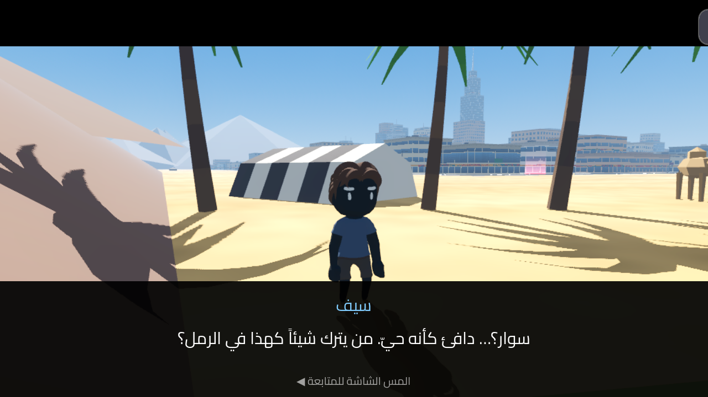
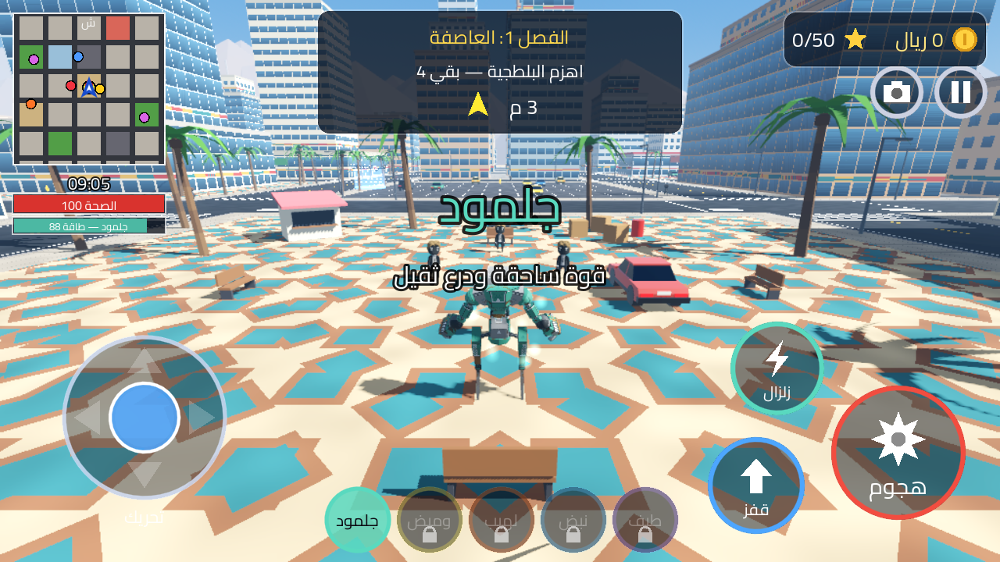
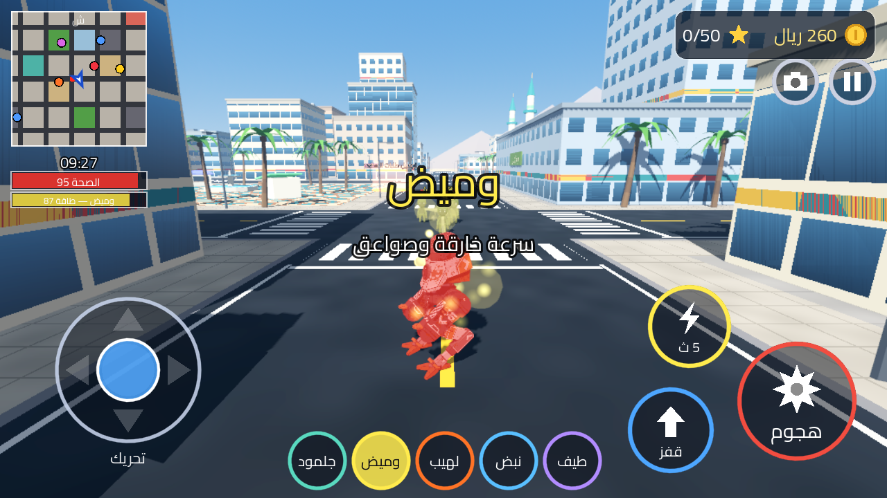
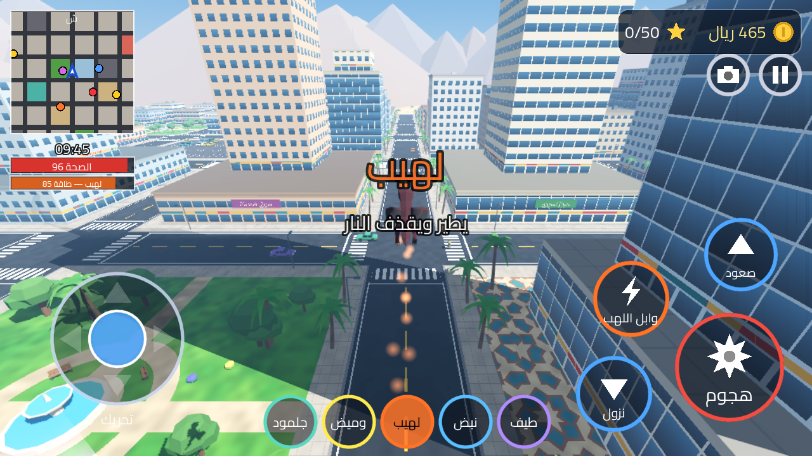
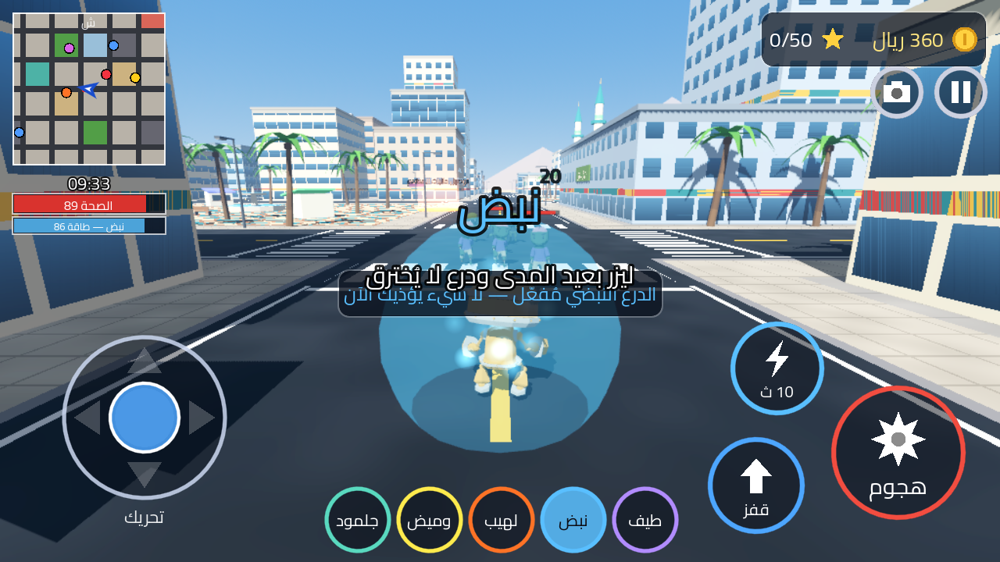
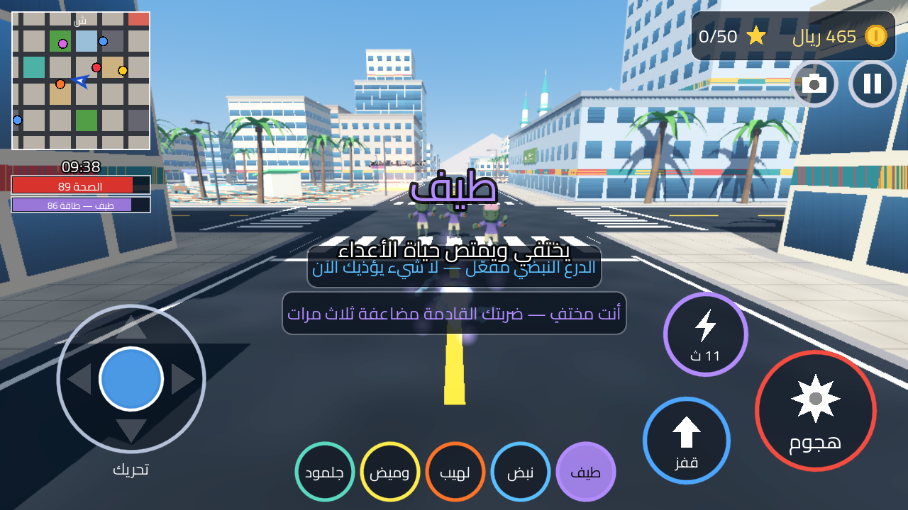
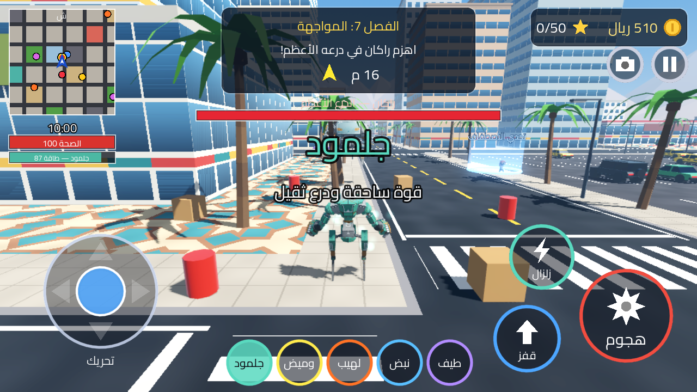
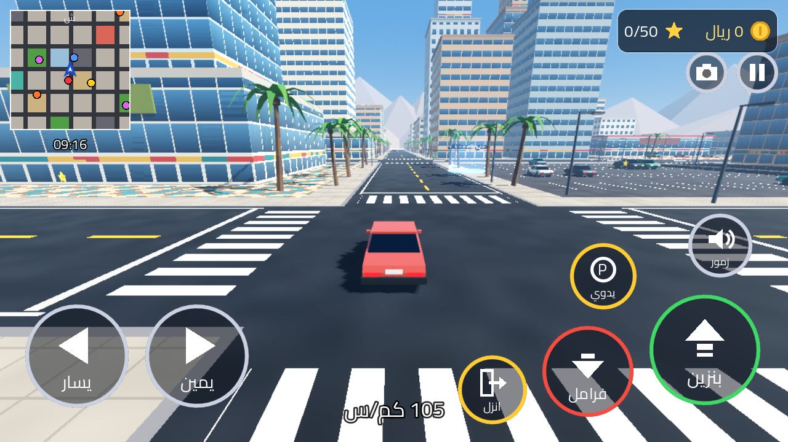

# حارس النخيل 🌴⚡

لعبة بطل خارق في عالم مفتوح ثلاثي الأبعاد للأندرويد، مبنية على **Godot 4.5**، بقصة وحوار عربي كامل.

«سيف» شاب يعثر بعد عاصفة صحراوية على سوار قديم ينام فيه **خمسة حرّاس**. كل حارس هيئة يتحوّل إليها،
ولكل هيئة هجوم وقدرة خاصة. وشركة «أفق للطاقة» بقيادة راكان تريد السوار بأي ثمن.

> لعبة أصلية: الاسم والشخصيات والقصة والمدينة كلها من صنعنا.

## الهيئات الخمس

| الهيئة | الهجوم | القدرة الخاصة | الميزة |
|---|---|---|---|
| **جلمود** — آلي ثقيل | قبضة حديدية | **زلزال**: يطيّر كل من حوله ويفجّر السيارات | درع ثقيل، يتحمّل الضرب |
| **وميض** — آلي نحيف بنصال | نصل خاطف مع اندفاع | **صاعقة متسلسلة** تقفز بين ٦ أعداء | سرعة جري خارقة |
| **لهيب** — تنّين | كرات نار | **وابل اللهب**: ٧ كرات متفجّرة | **يطير** بحرية فوق المدينة |
| **نبض** — روبوت | شعاع ليزر بعيد المدى | **درع نبضي** يمنع كل ضرر + موجة صدّ | قتال من بعيد |
| **طيف** — هيكل شبحي | لمسة تمتص حياة العدو | **اختفاء**: لا يراك أحد، وضربتك التالية ×٣ | التسلّل |

التحوّل يستهلك **طاقة السوار**. عُد إلى هيئتك البشرية لتستعيدها (وهي الهيئة الوحيدة التي تركب السيارات).

## القصة — ٧ فصول بمشاهد سينمائية

1. **العاصفة** — العثور على السوار وأول تحوّل.
2. **جنود أفق** — معركة حول برج النخيل.
3. **سباق مع الصاعقة** — دمّر أربعة أجهزة في أنحاء المدينة قبل انتهاء الوقت.
4. **سماء المدينة** — قتال جوّي فوق البحر.
5. **الاختيار** — زعيم آلي، ثم **قرار يغيّر النهاية**.
6. **تسلّل** — ادخل المستودع دون أن يراك الحرّاس.
7. **المواجهة** — راكان في درعه الأعظم.

كل فصل يبدأ من **العمود البنفسجي** على الخريطة. المشاهد فيها كاميرا متحركة وحوار يُكتب على الشاشة،
ويمكن تخطّيها بزر «تخطي المشهد».

## ماذا يوجد أيضاً؟

- **أعداء بأنواع**: بلطجية، جنود يطلقون النار، متحوّلون سريعون، خفافيش طائرة، وزعيمان آليّان.
- **تدمير**: السيارات تتضرر وتنفجر، وبراميل متفجّرة وصناديق تتحطم.
- **جرائم شوارع عشوائية** بعد الفصل الأول (نقاط حمراء في الخريطة).
- **المدينة المفتوحة كاملة**: ٦ سيارات للقيادة، مرور ومشاة، ليل ونهار، شاطئ وصحراء.
- **١١ مهمة جانبية** (تاكسي، توصيل، سباقات، اصطفاف، القطة الضائعة) + ٥٠ نجمة مخفية.
- **حفظ تلقائي** للتقدم.

## الأزرار

| البطل | في السيارة |
|---|---|
| العصا (يسار الشاشة): تحريك | يسار / يمين: التوجيه |
| سحب على الشاشة: تدوير الكاميرا | بنزين / فرامل |
| **هجوم** (ضغط مطوّل): يصوّب تلقائياً لأقرب عدو | يدوي: فرملة اليد |
| **قدرة**: القدرة الخاصة للهيئة | زمور |
| **أزرار الهيئات الخمسة** أسفل الشاشة: تحوّل / ارجع بشراً | انزل |
| قفز — ومع «لهيب»: صعود / نزول | |

على الكمبيوتر: WASD حركة، J هجوم، K قدرة، 1–5 الهيئات، R عودة للبشري، Space قفز/صعود، Q نزول،
E ركوب، F بدء المهمة، Enter متابعة الحوار، Esc إيقاف.

## التثبيت على الأندرويد

- كل دفعة (push) تبني ملف APK تلقائياً عبر GitHub Actions: افتح تبويب **Actions** ← آخر تشغيل ← نزّل `haris-alnakheel-apk`.
- انسخ الملف للجوال، افتحه، واسمح بالتثبيت من «مصادر غير معروفة».

## الشخصيات والأنيميشن

كل الشخصيات (البطل، الهيئات الخمس، الأعداء، المشاة) **مجسمات جاهزة بهيكل عظمي وأنيميشن حقيقي**،
من صنع الفنان [Quaternius](https://quaternius.com) برخصة **CC0** (ملكية عامة) — التفاصيل في `models/LICENSE.txt`.
المدينة والسيارات والمؤثرات والأصوات مولّدة بالكود. الخط العربي «Cairo» برخصة OFL.

## التعديل على اللعبة

1. نزّل [Godot 4.5](https://godotengine.org/download) وافتح المجلد (`project.godot`).
2. اضغط ▶ للتشغيل. للتصدير: Project ← Export ← Android.

| الملف | الوظيفة |
|---|---|
| `scripts/player.gd` | البطل، الهيئات الخمس (جدول `FORMS`)، الهجمات والقدرات |
| `scripts/character_rig.gd` | تحميل المجسمات وتشغيل أنيميشنها (جدول `MODELS`) |
| `scripts/enemy.gd` | أنواع الأعداء وذكاؤهم (جدول `KINDS`) |
| `scripts/combat.gd` | المقذوفات، الليزر، الانفجارات، المؤثرات |
| `scripts/story.gd` | الفصول، الحوارات، الأهداف |
| `scripts/cutscene.gd` | نظام المشاهد السينمائية والاختيارات |
| `scripts/city.gd`, `scripts/car.gd` | المدينة والسيارات والمرور |
| `scripts/missions.gd` | المهمات الجانبية والنجوم |
| `scripts/hud.gd`, `scripts/touch_controls.gd`, `scripts/menu.gd` | الواجهة وأزرار اللمس |
| `models/` | مجسمات الشخصيات (FBX) |
| `tools/simtest.gd` | اختبار آلي للّعب كاملاً: `godot --headless -- --simtest` |

لإضافة شخصية بمجسم آخر: ضع ملف `.fbx` أو `.glb` في `models/`، وأضف سطراً في جدول `MODELS` بأسماء الأنيميشن.

## صور

